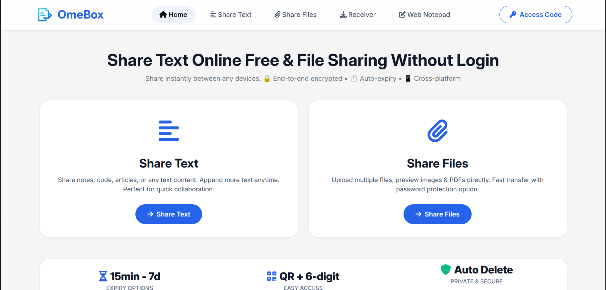
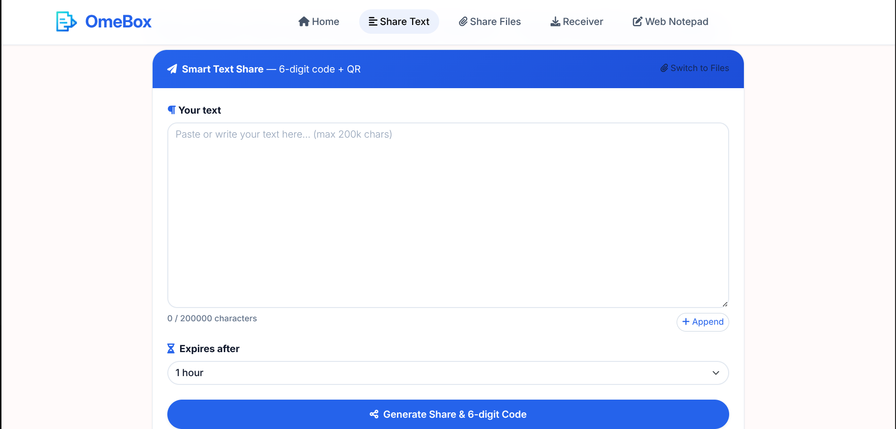
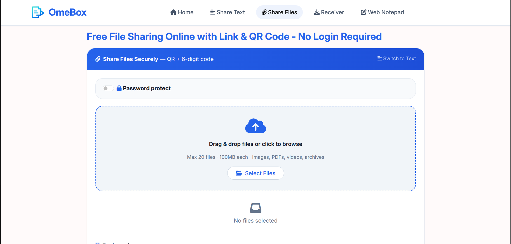
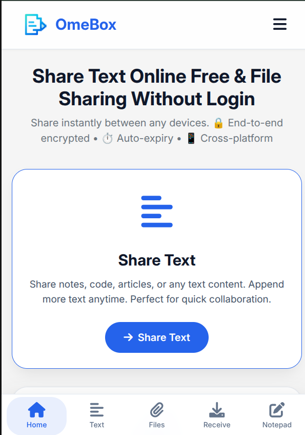

# 🎁 OmeBox

### Fast Text & File Sharing — Share text, code snippets, and files online with ease.

**OmeBox** · **Ome Box** · **ome-box** · **omebox.com**

[🌐 Visit Website](https://omebox.com) · [🐛 Report Bug](https://github.com/yourusername/omebox/issues) · [💡 Request Feature](https://github.com/yourusername/omebox/issues)

---

## 📖 What is OmeBox?

**OmeBox** is a web-based **text and file-sharing platform** designed to make sharing information fast, simple, and convenient. It enables users to share **text**, **code snippets**, and **files** through shareable links — **without requiring account registration**.

Built for **students**, **developers**, **teachers**, and **professionals**, OmeBox delivers a straightforward sharing experience across desktop and mobile devices.

> 🚀 **Try it now:** [https://omebox.com](https://omebox.com)

---

## 🌟 Key Features

- 📝 **Text Sharing** — Share text and code snippets via shareable links
- 📁 **File Sharing** — Upload and share files online
- 🔗 **Shareable URLs** — Access shared content through generated links
- 🚫 **No Mandatory Registration** — Share without creating an account
- 📱 **Responsive Interface** — Works on desktop, tablet, and mobile
- ⏳ **Temporary Sharing** — Support for expiring content *(where implemented)*
- 🔐 **Access Codes** — Additional access protection *(where implemented)*
- ✨ **Simple UX** — Focused on convenient, straightforward sharing

> Feature availability depends on the current implementation of the live website.

---

## 📸 Screenshots

### 🏠 Homepage

### 📝 Text Sharing

### 📁 File Sharing

### 📱 Mobile View

---

## 🖥️ Frontend Technologies

| Technology | Purpose |
|------------|---------|
| **HTML5** | Page structure and content |
| **CSS3** | Styling and responsive layouts |
| **JavaScript** | Client-side interactivity |
| **Bootstrap** | Responsive components and interface design |

---

## ⚙️ Backend Architecture

OmeBox has used **two backend technology stacks** during its development.

### 1️⃣ Original Backend Stack

| Component | Technology |
|-----------|------------|
| Language | **Python** |
| Framework | **Flask** |
| Database | **SQLite** |

The original backend was developed using **Flask** and **SQLite**, providing the initial backend foundation for the website.

### 2️⃣ Updated Backend Stack

| Component | Technology |
|-----------|------------|
| Language | **Python** |
| Framework | **FastAPI** |
| Database | **MongoDB** |

The second backend stack was introduced to address **user-control and application requirements**. FastAPI provides an alternative Python backend framework, while MongoDB provides a document-oriented database.

### 🔄 Backend Comparison

| Component | Original Backend | Updated Backend |
|-----------|------------------|-----------------|
| Language | Python | Python |
| Framework | Flask | FastAPI |
| Database | SQLite | MongoDB |
| Role | Original implementation | Updated implementation |

### 💡 Why the Backend Evolved

As OmeBox developed, the original **Flask + SQLite** implementation encountered user-control and application requirements that motivated a change in approach. The project subsequently adopted a **FastAPI + MongoDB** stack to support its evolving requirements.

> The actual performance, scalability, and reliability benefits depend on the implementation, deployment configuration, and workload.

---

## 🎯 Target Users

| User | Use Case |
|------|----------|
| 🎓 **Students** | Sharing notes, assignments, and study materials |
| 👨‍💻 **Developers** | Sharing code snippets and technical content |
| 👩‍🏫 **Teachers** | Exchanging educational materials |
| 💼 **IT Professionals** | Sharing text and files for collaboration |
| 🌍 **General Users** | Sharing information conveniently online |

---

## 🔐 Privacy and Security

OmeBox aims to make sharing **convenient** while supporting **responsible handling** of shared content.

> ⚠️ **Users should avoid sharing passwords, financial information, or other sensitive personal data through shareable links.**

Security depends on the actual implementation of access controls, link generation, file validation, rate limiting, and expiration handling.

---

## 🚀 Project Vision

> Our vision is to make online text and file sharing **accessible**, **convenient**, and **efficient**.

OmeBox continues to evolve with the goal of providing a simple sharing experience for people across different devices and use cases.

---

## 🤝 Feedback and Contributions

Suggestions, feedback, and ideas for improving OmeBox are **welcome**!

Please review [CONTRIBUTING.md](CONTRIBUTING.md) before proposing changes.

---

## 📄 Repository Purpose

This GitHub repository **showcases** the OmeBox website, its features, technology stack, and development journey.

> ⚠️ It **does not necessarily contain** the complete production source code or deployment configuration of the live website.

---

## 🔍 Search Keywords

`omebox` · `ome box` · `ome-box` · `omebox.com` · `omebox text sharing` · `omebox file sharing` · `share text online` · `share files online` · `code snippet sharing` · `temporary file sharing` · `no registration file share` · `text share free` · `Text Share Online` · `omebox web app` · `omebox github`

---

## 📜 License

This repository showcases **OmeBox.com**, an online text and file-sharing platform. Visit [OmeBox.com](https://omebox.com) to explore the website.

---

**OmeBox — Share Fast. Share Simple.** 🚀

Made with ❤️ by the OmeBox Team

⭐ **Star this repo** if you find it useful!

